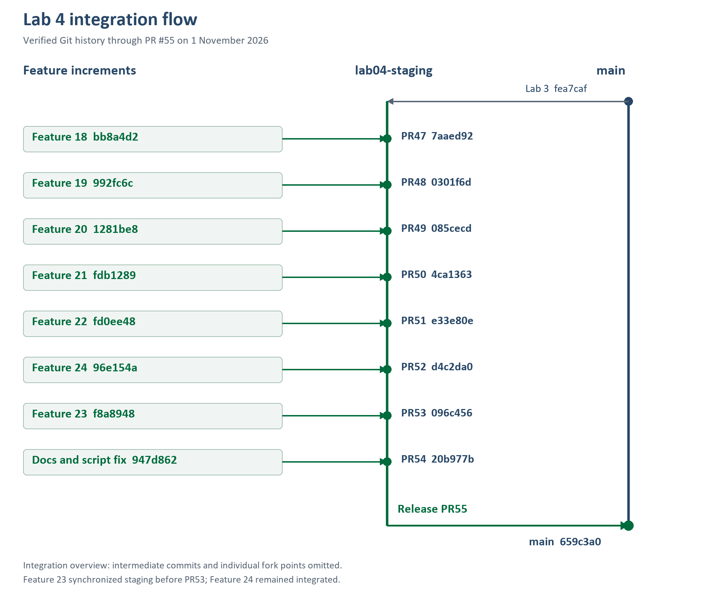

# Lab 4 evidence index

Release preparation began 31 October 2026 from `lab04-staging` at `e33e80e`.
This is an evidence index, not a completed release or final-main certification.

| Increment | Published evidence | Integration status on 1 November 2026 |
| --- | --- | --- |
| Feature 18 / #40 | Contract in `docs/lab-04/`; commit `bb8a4d2` | PR #47 merged |
| Feature 19 / #41 | Validation `992fc6c`; supporting persistence in Feature 21 | PR #48 merged |
| Feature 20 / #42 | [UI contract checks](feature-42-verification.md), `1281be8` | PR #49 merged |
| Feature 21 / #43 | [Real workflow/API/browser evidence](feature-21-verification.md), `fdb1289` | PR #50 merged |
| Feature 22 / #44 | [Owned dashboard evidence](feature-22-verification.md), `fd0ee48` | PR #51 merged |
| Feature 23 / #45 | [Published staff dashboard evidence](https://github.com/N0M3KM/TokTickIT/blob/f8a8948/artifacts/lab-04/feature-23-verification.md), `f8a8948` | PR #53 merged; staging 096c456 |
| Feature 24 / #46 | [Fixture and seed/recovery evidence](release-preparation.md) | PR #52 merged; final release pending |

Screenshots use synthetic fixtures and identify role/viewport/state in each
feature record. `*-mocked-*` images are mock-only; `*-real-*` checks used actual
disposable PostgreSQL/API services. No production databases, private uploads,
tokens or real passwords belong here. Transient runner output is ignored.

Current staging is `20b977b5ac12477bbce8beea16a7eebfa79f081f` after PR #54; main is `659c3a0` after PR #55.
The PR #53 merge retained both test scripts but missed their comma; PR #54 repaired the syntax before the main release. Previous test totals remain historical, not combined-staging results.

## Remaining release gates

- Features 23 and 24 are both integrated into staging; neither needs remerging.
- Fixture migration verified: client 214/214 and server 388/388. Verify the combined staging release; reuse unaffected feature evidence.
- Repeat-seed and separate database/files logical recovery verified in preparation.
- Remaining UI/accessibility/visual checklist with actual observations.
- Independent approvals for PRs #47-53 are recorded in docs/lab-04/reviewer.md; student reflection confirmation remains.
- Main release PR #55 and SHA verified; post-merge test execution remains outstanding.
- Single final Answer Part 1..9 PDF after its evidence/human sections are available.
  Never substitute invented approvals, reflection or final-main results.

## Main release update on 1 November 2026

[PR #54](https://github.com/N0M3KM/TokTickIT/pull/54) merged documentation and the script comma correction into staging at `20b977b5ac12477bbce8beea16a7eebfa79f081f` (11:53:20 UTC). [PR #55](https://github.com/N0M3KM/TokTickIT/pull/55) then merged staging into main at `659c3a033a9b533715652ffcfdfd9355e9349ea7` (11:54:03 UTC). Both test scripts are present in valid main package JSON. The release PR returned no approval review or author comment.

The merge and SHA are verified; earlier 214-client/388-server results remain tied to preparation commit 96e154a. No final-main tests were rerun for this documentation update. Remaining final-main verification, manual accessibility and Done-board evidence are not marked complete.

