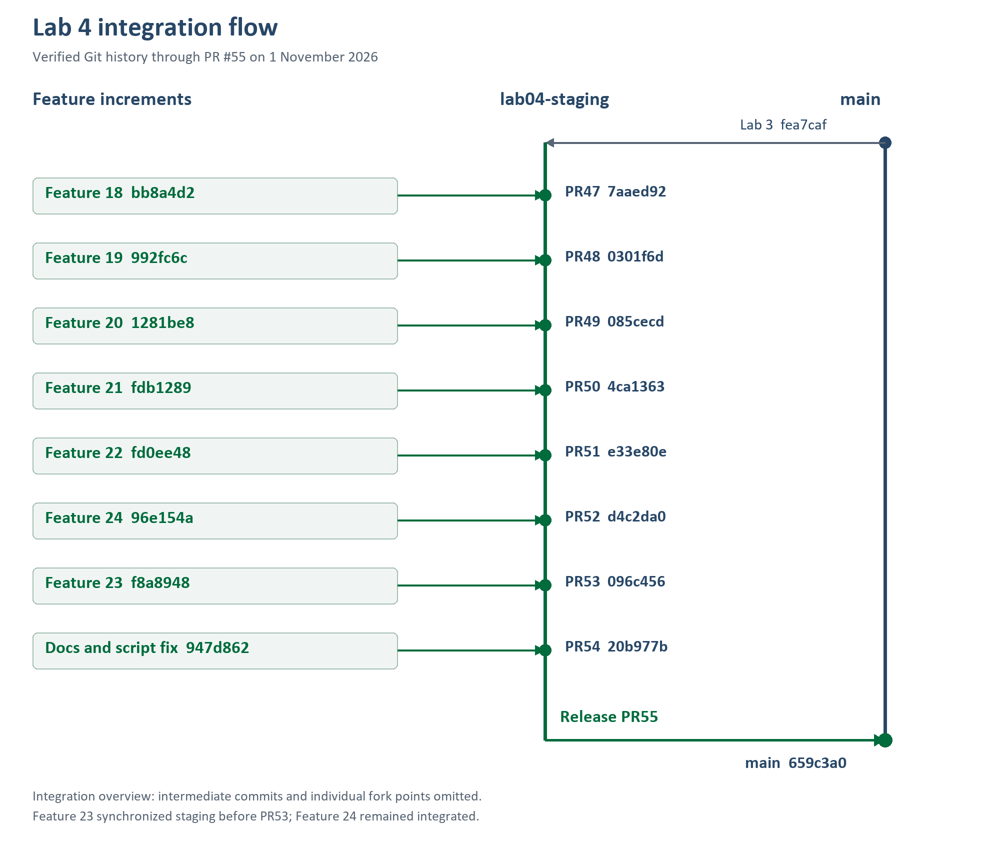

# Lab 4 Engineering Contract

**Status updated 1 November 2026:** Features 18-22 and 24 are integrated through PRs #47-52; Feature 23 followed in PR #53. Current staging is `20b977b` after PR #54. Lab 4 is released to main at `659c3a0` through PR #55; no final-main test run is claimed. Historical contract and planned-test language below describe the original drafting stage; actual results are indexed in `artifacts/lab-04/README.md`.

This folder follows the Lab 3 documentation style while preserving `../lab-03/`. The Lab 4 handout explicitly requires `docs/lab-04/` in sections 4.4, 6, 9, 10 and 12.

| Document | Purpose |
| --- | --- |
| [specification.md](specification.md) | Eleven-section engineering contract, FR/BR/AC, data decisions, development workflow and completion gates |
| [tests.md](tests.md) | Planned tests, complete AC mapping, evidence and regression gates |
| [ui-spec.md](ui-spec.md) | Zen Green screens, interaction states, accessibility and screenshot checklist |
| [api-spec.md](api-spec.md) | Proposed REST additions, validation, security, concurrency and dashboard queries |
| [issues.md](issues.md) | Copy-ready issue drafts using the previous GitHub issue template |
| [reviewer.md](reviewer.md) | Unfilled peer-review evidence register |
| [ai-use.md](ai-use.md) | Honest AI-use record and future prompt/evidence guidance |
| [submission-checklist.md](submission-checklist.md) | All nine required report parts and evidence destinations |

## Source and precedence

- Source: `SE+Lab+4 (1).pdf`, 11 pages, supplied by the user; page/section traceability is in the specification.
- Baseline: Lab 2/3 contracts, current Prisma schema, active client entry `client/src/main.tsx`, and server routes at local commit `8d06226`.
- Issue style checked against [GitHub issue 27](https://github.com/N0M3KM/TokTickIT/issues/27), [30](https://github.com/N0M3KM/TokTickIT/issues/30) and [32](https://github.com/N0M3KM/TokTickIT/issues/32): title, Type, Branch, Acceptance criteria.
- The user's requested branch name is **`lab04-staging`**, even though the handout's submission example says `lab4-staging`. Use `main -> lab04-staging -> feature/*`, with reviewed integration in the reverse direction.
- Proposed choices in specification section 11 need owner acceptance before implementation. The handout requests a resolution gate and action lifecycle but does not prescribe their exact rules.
- Logical feature numbers 18-24 continue the previous 12-17 naming convention; their actual GitHub issues are #40-46 respectively (see issues.md).

Read `specification.md` first, then the API/UI/test contracts and the selected issue. The owner authorized issue creation and Feature 18 commit/push, followed by local uncommitted Feature 19 work. Feature 19 must not be committed or pushed until the owner verifies and merges Feature 18 into `lab04-staging`. No automatic merge is authorized.

## Main release update on 1 November 2026

[PR #54](https://github.com/N0M3KM/TokTickIT/pull/54) merged documentation and the script comma correction into staging at `20b977b5ac12477bbce8beea16a7eebfa79f081f` (11:53:20 UTC). [PR #55](https://github.com/N0M3KM/TokTickIT/pull/55) then merged staging into main at `659c3a033a9b533715652ffcfdfd9355e9349ea7` (11:54:03 UTC). Both test scripts are present in valid main package JSON. The release PR returned no approval review or author comment.

The merge and SHA are verified; earlier 214-client/388-server results remain tied to preparation commit 96e154a. No final-main tests were rerun for this documentation update. Remaining final-main verification, manual accessibility and Done-board evidence are not marked complete.

